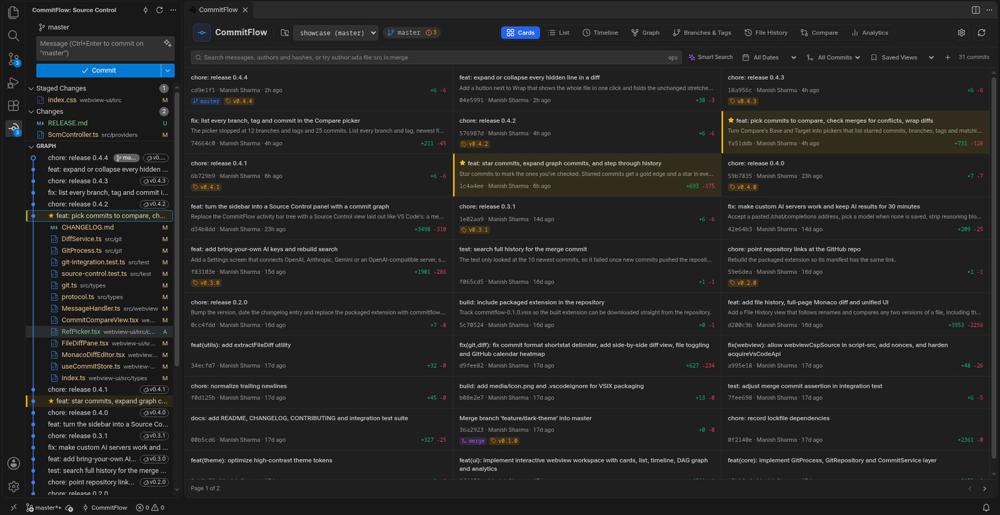
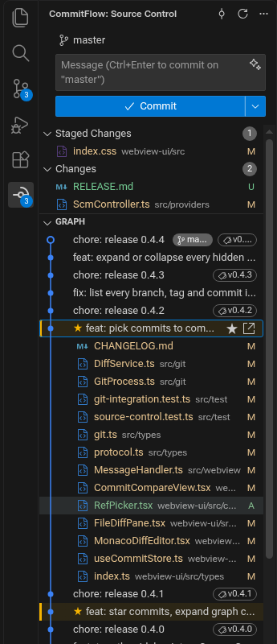
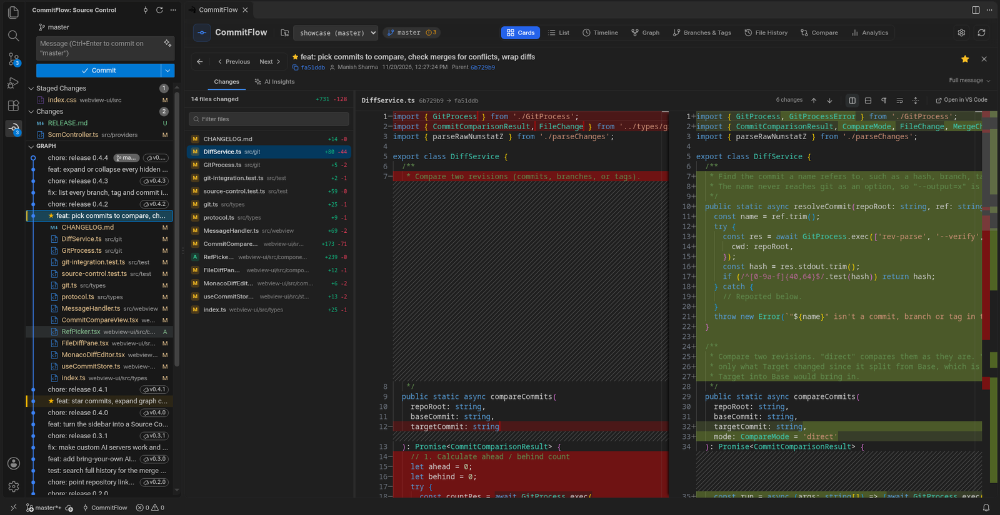
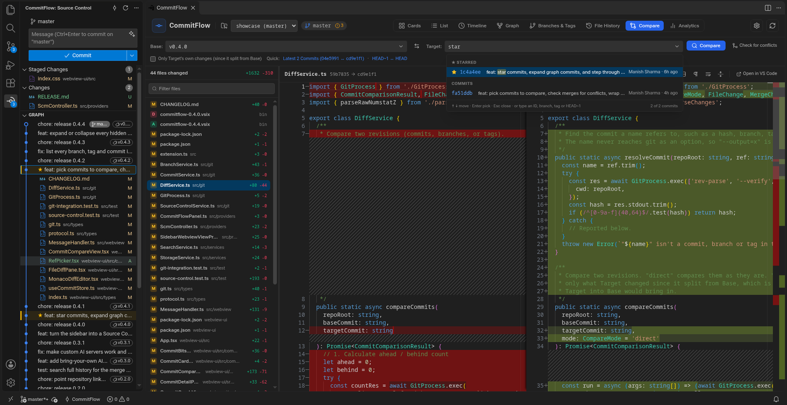
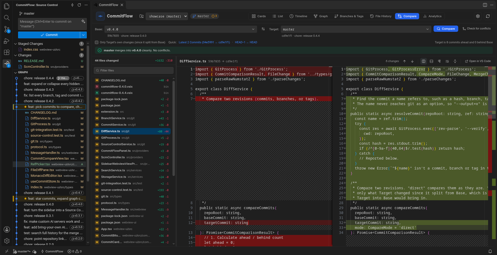
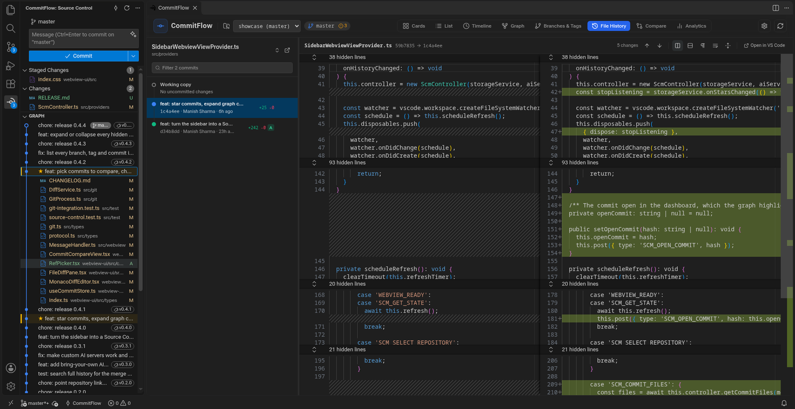
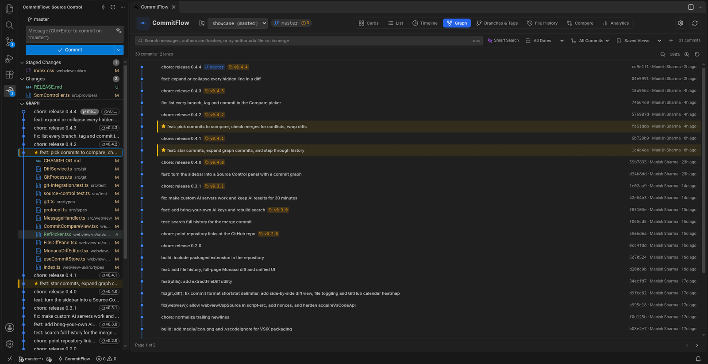
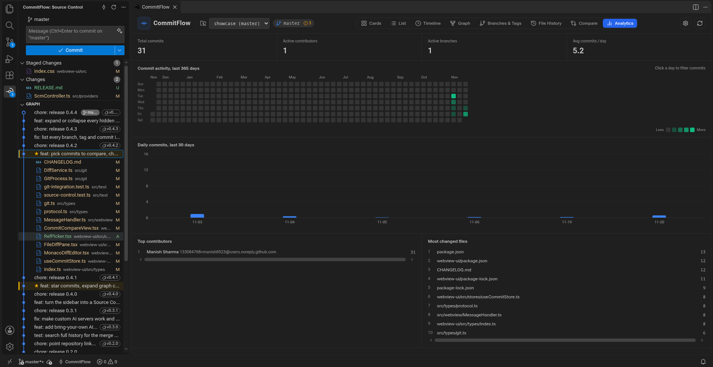

  

<h1 align="center">CommitFlow</h1>

  <b>See your whole Git history at a glance, and do your everyday Git work without leaving VS Code.</b> 
  A Source Control sidebar with a commit graph, a visual history dashboard, side-by-side diffs, 
  file history, a branch and commit comparer with a conflict check, and optional AI.

  
  
  

  

---

## Why CommitFlow

| | |
| :-- | :-- |
| 🧭 **Source Control, upgraded** | Stage, commit, amend, push, pull, sync and stash from a sidebar that looks and works like VS Code's own, with a commit graph underneath. |
| 🗂️ **History you can scan** | Browse commits as cards, a list, a timeline or a branch graph. Click any commit for its full change. |
| 🔍 **Search that understands Git** | Find commits by words, author, date, file, branch, tag or the code they changed. |
| 🆚 **Compare anything** | Pick two commits, branches or tags, see every change between them, and check for merge conflicts before you merge. |
| 📜 **File history** | Follow one file through every commit, across renames, and compare any two versions. |
| ⭐ **Stars for review** | Star the commits you've checked. They stay gold in every view, and one filter lists only them. |
| ✨ **Optional AI** | Write commit messages, review commits and search in plain English with your own OpenAI, Anthropic, Gemini or self-hosted model. Off until you turn it on. |

---

## Features

### Source Control sidebar

<table>
  <tr>
    <td width="360" valign="top"></td>
    <td valign="top">

Click the **CommitFlow** icon in the Activity Bar.

- **Commit** with `Ctrl+Enter`. The button's menu offers **Commit (Amend)**, **Commit & Push**, **Commit & Sync** and **Undo Last Commit**.
- Click ✨ to **generate a commit message** from your changes, with AI or a built-in fallback.
- **Merge Changes**, **Staged Changes** and **Changes**, as a list or a folder tree. Hover a file to open, discard or stage it. Right-click for more, including **Open File History**.
- Select several files with `Ctrl` or `Shift` and act on all of them.
- **Sync**, **Publish Branch** and branch switching from the branch name at the top.
- **Stashes**: apply, pop or drop.
- **Graph** of your branch and incoming commits. Click a commit to list its files, and click a file to see its change. Older commits load as you scroll.
- The change count shows on the icon, and everything refreshes on its own.

  </td>
  </tr>
</table>

### Commit details and diffs

- A full-page, side-by-side or inline **diff** with syntax highlighting and word-level changes.
- Toolbar buttons to **wrap long lines**, **expand or collapse unchanged lines**, ignore whitespace, and jump between changes (`F7` / `Shift+F7`).
- **Previous** and **Next** step to the commit made just before or after, along your branch.
- **AI Insights** sums up a commit, rates its risk and lists its key changes.
- One click opens the change in VS Code's own diff editor.

### Compare branches, tags and commits

- **Base** and **Target** open a list of starred commits, every branch and tag, and recent commits. Type to filter your whole history, or enter any ID, branch, tag or `HEAD~1`.
- **⇄** swaps the two.
- **Only Target's own changes** compares from where the branches split, so you see exactly what a merge would bring in.
- **Check for conflicts** runs a trial merge without touching your files and lists any file that would conflict. Click one to see the clashing lines.

### File history

Open any file's history from the editor title bar, the Explorer, the sidebar or the dashboard. CommitFlow follows the file across renames. Click a commit to see what it changed, or mark any two versions as **A** and **B** to compare them, including your working copy.

### Commit graph

Branch lanes, merges, branch and tag labels, and stars, with zoom. Hover any commit to copy its ID, compare it with `HEAD`, check it out, cherry-pick or revert it.

### Analytics

A year-long activity heatmap, daily commits, top contributors and the files that change most. Click a day, a person or a file to filter the history.

### Search

Type words to find commits containing all of them, in any order, across messages, authors, branches, tags and IDs. Narrow it down with:

| Operator | Finds |
| :-- | :-- |
| `author:manish` / `committer:` | Commits by a name or email |
| `after:2026-11-01` / `before:` | Commits on or after, or before, a date |
| `file:src/git` | Commits that touched a path, folder or glob such as `*.tsx` |
| `code:resolveCommit` | Commits that added or removed this text |
| `branch:main` / `tag:v1.0` | Commits on a branch, or with a tag |
| `is:merge` / `is:non-merge` | Merge commits, or everything else |
| `hash:fa51ddb` | One commit, by full or short ID |

With AI on, **Smart Search** turns "what Manish changed in the login page last week" into a query for you.

### Stars

Click ☆ on any commit to mark it as checked. Starred commits get a gold edge and a ★ everywhere, and **★ Starred** in the commit filter lists only them. Stars are saved on your computer for each repository and never change your Git history.

---

## Getting started

1. Install **CommitFlow**. Or download the `.vsix` from the [latest release](https://github.com/Manish6523/commitflow/releases/latest) and run **Extensions: Install from VSIX…**.
2. Open a folder that contains a Git repository.
3. Click the **CommitFlow** icon in the Activity Bar for Source Control, or run **CommitFlow: Open Commit Dashboard** from the Command Palette (`Ctrl+Shift+P`).

### AI, if you want it

AI features are **off by default**, and CommitFlow works fully without them.

1. Run **CommitFlow: Configure AI**, or click the ⚙ in the dashboard.
2. Choose **OpenAI**, **Anthropic**, **Google Gemini** or **Custom server** (any OpenAI-compatible server, such as Ollama, LM Studio or FreeLLMAPI).
3. Paste your API key and click **Test connection**.

Your key is stored in VS Code's encrypted secret storage. When AI is on, the commit messages, file names and diffs you ask about are sent to the provider you chose. Files such as `.env` and private keys are always left out.

---

## Commands

| Command | What it does |
| :-- | :-- |
| **CommitFlow: Open Commit Dashboard** | Opens the history dashboard |
| **CommitFlow: Refresh Repository** | Reloads the sidebar and the dashboard |
| **CommitFlow: Search Commits** | Jumps to the search box |
| **CommitFlow: Open File History** | Shows the history of the current file |
| **CommitFlow: Compare Commits** | Opens the Compare page |
| **CommitFlow: Open Specific Commit** | Opens one commit by ID |
| **CommitFlow: View Branches & Tags** / **View Analytics & Insights** | Opens those pages |
| **CommitFlow: Checkout / Cherry-Pick / Revert Commit** | Runs that action on a commit |
| **CommitFlow: Create Branch / Create Tag from Commit** | Starts a branch or tag at a commit |
| **CommitFlow: Configure AI** | Sets up your AI provider and key |
| **CommitFlow: Pull / Push / Sync / Fetch / Stash / Switch Branch…** | The sidebar's `⋯` menu, also in the Command Palette |

## Settings

| Setting | Default | Description |
| :-- | :-- | :-- |
| `commitflow.pageSize` | `30` | Commits per page in the dashboard |
| `commitflow.defaultViewMode` | `grid` | The view the dashboard opens with |
| `commitflow.dateFormat` | `relative` | How commit times are shown |
| `commitflow.enableAI` | `false` | Use your AI provider for AI features |
| `commitflow.aiProvider` | `openai` | `openai`, `anthropic`, `gemini` or `custom` |
| `commitflow.aiModel` | | The model to use; picked for you when left empty |
| `commitflow.aiBaseUrl` | | Your server's address, for the `custom` provider |

## Requirements

- VS Code 1.85 or newer.
- Git on your `PATH`. **Check for conflicts** needs Git 2.38 or newer; everything else works with older versions.

## Privacy

CommitFlow reads your repository with your own `git` and keeps everything on your computer. It collects no telemetry. Nothing leaves your machine unless you turn on AI, and then only what's described above goes to the provider you chose.

---

  <a href="https://github.com/Manish6523/commitflow/blob/master/CHANGELOG.md">Changelog</a> ·
  <a href="https://github.com/Manish6523/commitflow/issues">Report an issue</a> ·
  <a href="https://github.com/Manish6523/commitflow">Source on GitHub</a> ·
  MIT License

